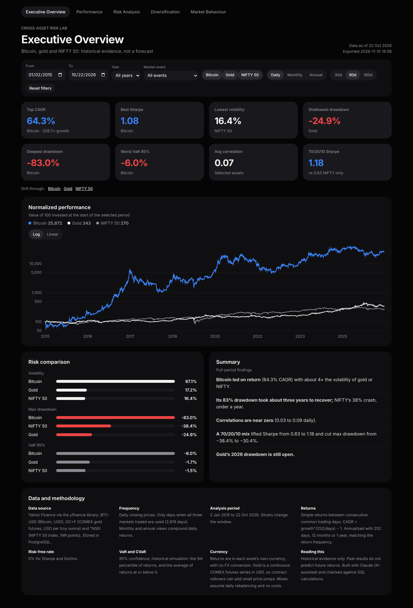
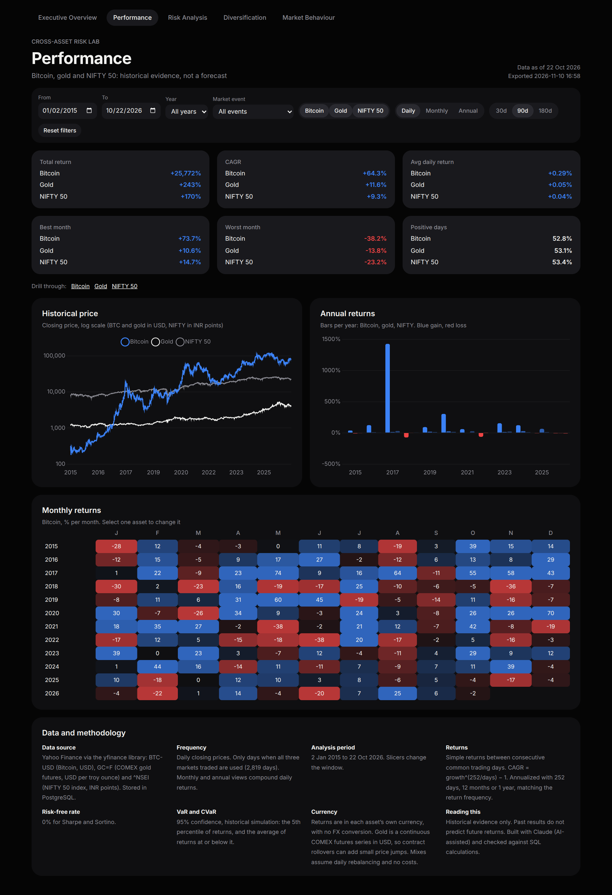
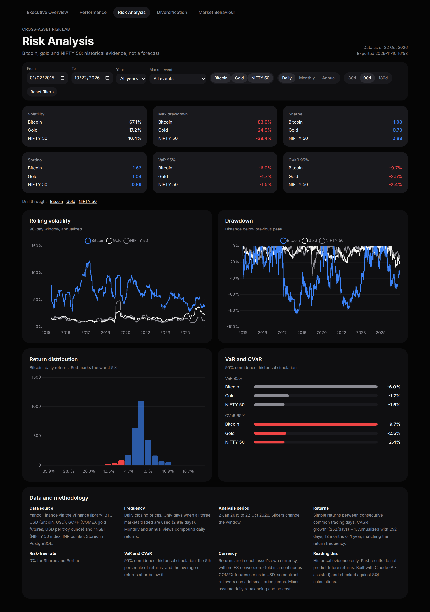
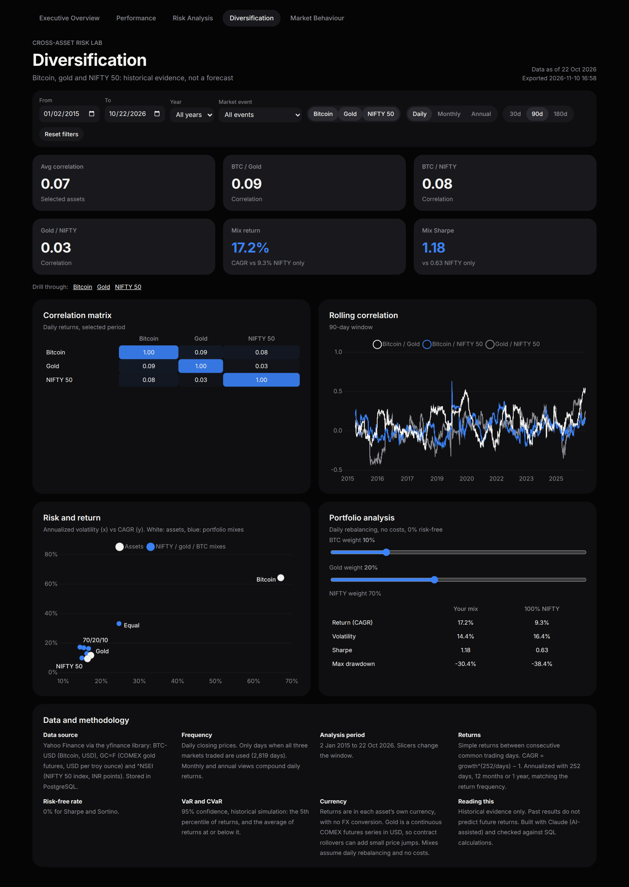
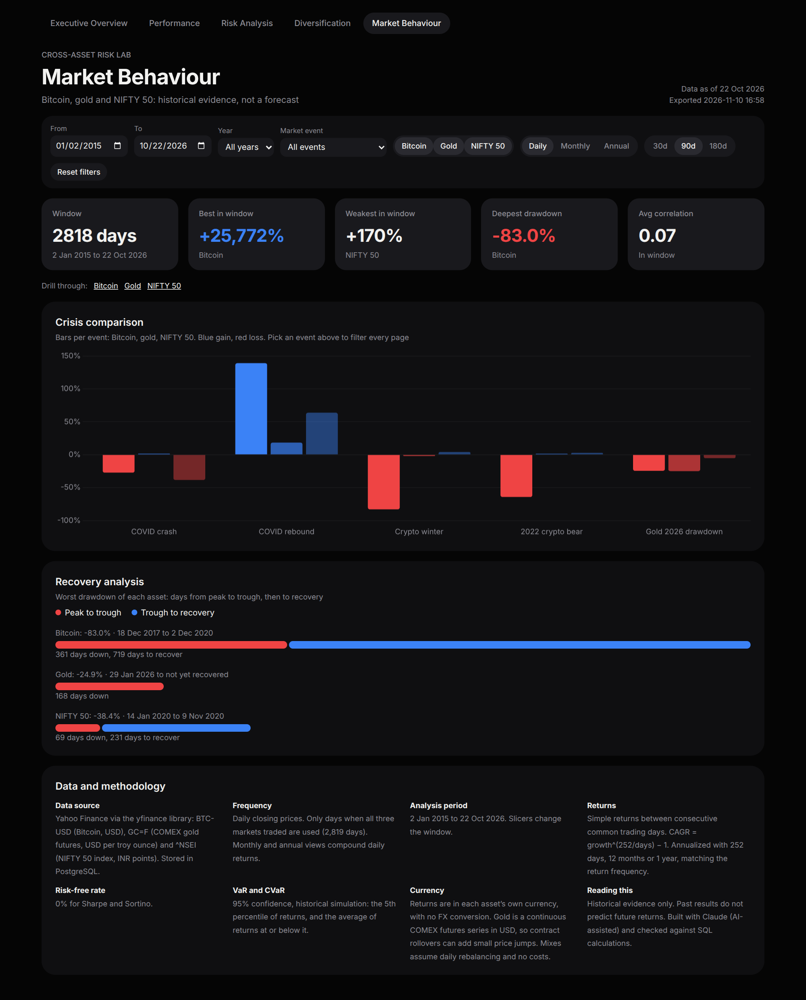

# Cross-Asset Risk Analysis: Bitcoin vs Gold vs NIFTY 50

**An end-to-end analytics project: market data from Yahoo Finance, a PostgreSQL warehouse, a documented SQL analysis, and a five-page interactive dashboard built with AI assistance (Claude) and validated against independent calculations.**

**Live dashboard:** https://YOUR_USERNAME.github.io/cross-asset-risk-analysis/



---

## Contents

1. [Executive summary](#executive-summary)
2. [What makes this project different](#what-makes-this-project-different)
3. [Key findings](#key-findings)
4. [The dashboard](#the-dashboard)
5. [How I used AI (Claude) to build it](#how-i-used-ai-claude-to-build-it)
6. [Architecture and workflow](#architecture-and-workflow)
7. [Data and methodology](#data-and-methodology)
8. [Data quality and validation](#data-quality-and-validation)
9. [Repository structure](#repository-structure)
10. [How to run](#how-to-run)
11. [Limitations](#limitations)
12. [Skills demonstrated](#skills-demonstrated)
13. [What comes next](#what-comes-next)

---

## Executive summary

**Question:** Does adding Bitcoin or gold to an Indian equity portfolio improve its risk profile, and did they actually help when markets fell?

**Scope:** daily prices for Bitcoin (BTC-USD), gold (GC=F, COMEX gold futures) and the NIFTY 50 index (^NSEI) from 2 Jan 2015 to 22 Oct 2026: 2,819 days on which all three markets traded and 2,818 daily returns.

**Answer, in one paragraph:** Bitcoin delivered by far the highest return (64.35% CAGR) but with about four times the volatility of gold or NIFTY, an 83% maximum drawdown and roughly three years to recover. Correlations between the three assets are low (0.03 to 0.09 daily). Gold stayed neutral on NIFTY's worst days, while Bitcoin tended to fall with NIFTY. Small allocations helped on this history: a 70% NIFTY / 20% gold / 10% Bitcoin mix lifted the Sharpe ratio from 0.63 to 1.18 and cut the maximum drawdown from -38.4% to -30.4%. Every conclusion is presented as **historical evidence, not a forecast**.

## What makes this project different

- **It is a risk study, not a chart gallery.** It uses the measures a risk team would use: CAGR, volatility, Sharpe, Sortino, historical VaR and CVaR, maximum drawdown, recovery time, rolling correlation, beta and a portfolio test.
- **It handles real-world data problems explicitly.** Bitcoin trades 7 days a week, gold and NIFTY only on market days; the assets are quoted in USD and INR; gold is a futures series. The analysis uses a documented common-trading-day calendar and states what each choice does to the results.
- **Every figure is reconciled.** SQL-rebuilt returns were matched to my independent CSV calculations; the dashboard scorecard was matched to the SQL output; the interactive portfolio engine was matched to the SQL portfolio table (see [validation](#data-quality-and-validation)).
- **Findings are written with their caveats.** For example, gold is called a "neutral diversifier", not a "safe haven", because the data does not support the stronger claim; average returns are distinguished from compounded returns; Monday returns that span a weekend are flagged.
- **The SQL file documents its own findings.** Each of the 15 analysis queries has a short FINDING comment with the numbers, what they mean, and what they do not prove.
- **The dashboard was built with AI, and I can show how.** A written specification went in; a working dashboard came out in minutes; a verification process made the numbers trustworthy. See [How I used AI](#how-i-used-ai-claude-to-build-it).
- **Nothing sensitive is in the repository.** Database credentials are read from an environment variable, and downloaded prices are not committed.

## Key findings

*All figures are historical, computed on common trading days, with a 0% risk-free rate.*

### Performance and risk scorecard

| | Bitcoin | Gold | NIFTY 50 |
|---|---|---|---|
| Growth of 1 unit | 258.7x | 3.43x | 2.70x |
| CAGR | **64.35%** | 11.64% | 9.30% |
| Annualized volatility | 67.07% | 17.23% | 16.37% |
| Sharpe ratio | 1.08 | 0.73 | 0.63 |
| Sortino ratio | 1.62 | 1.04 | 0.86 |
| 1-day VaR (95%) | -6.03% | -1.70% | -1.50% |
| 1-day CVaR (95%) | -9.72% | -2.53% | -2.41% |
| Maximum drawdown | -83.0% | -24.9% | -38.4% |
| Calmar ratio | 0.77 | 0.47 | 0.24 |
| Days up | 52.8% | 53.1% | 53.4% |

### Findings

1. **Bitcoin paid the most and hurt the most.** Its compounded return (64.35%) is lower than its average-return figure (72.4%) because of volatility drag, and its return depends heavily on one year: 2017 alone was +1,424.7%. Without 2017, the other 11 years compound to roughly 17x, not 259x.
2. **Drawdown depth and recovery time tell different stories.**

   | | Peak to trough | Depth | Recovered | Time underwater |
   |---|---|---|---|---|
   | Bitcoin | 18 Dec 2017 to 14 Dec 2018 | -83.0% | 2 Dec 2020 | 1,080 days (about 3 years) |
   | NIFTY 50 | 14 Jan 2020 to 23 Mar 2020 | -38.4% | 9 Nov 2020 | 300 days |
   | Gold | 29 Jan 2026 to 16 Jul 2026 | -24.9% | not yet | still open at the end of the data |

3. **Bitcoin spent most of the period below its previous high:** more than 10% below on 76.6% of days and more than 50% below on 30.3%. Gold and NIFTY were never more than 50% below a peak.
4. **Correlations are low but not zero.** Daily: BTC/gold 0.090, BTC/NIFTY 0.078, gold/NIFTY 0.034. Weekly returns, which reduce the effect of different market-closing times, give 0.083, 0.127 and 0.109. The rolling 90-day correlation peaked at 0.632 (BTC/NIFTY, 16 Mar 2020, the COVID crash).
5. **Hedge test: gold was neutral, Bitcoin was not.** On NIFTY's worst 5% of days (141 days, average -2.41%), gold averaged -0.01% against +0.05% normally, while Bitcoin averaged -0.64% against +0.29% normally, and its correlation with NIFTY rose from 0.078 to 0.214.
6. **Beta to NIFTY is small:** Bitcoin 0.32 (R-squared 0.6%), gold 0.04 (R-squared 0.1%). Over 99% of Bitcoin's daily movement is unrelated to NIFTY.
7. **Small allocations improved the risk profile** (daily rebalancing, no costs):

   | Portfolio | CAGR | Volatility | Sharpe | Max drawdown |
   |---|---|---|---|---|
   | 100% NIFTY | 9.30% | 16.37% | 0.63 | -38.4% |
   | 95% NIFTY / 5% BTC | 12.78% | 16.16% | 0.83 | -37.6% |
   | 90% NIFTY / 10% BTC | 16.25% | 16.66% | 0.99 | -37.0% |
   | 90% NIFTY / 10% gold | 9.80% | 14.89% | 0.70 | -35.1% |
   | 80% NIFTY / 10% gold / 10% BTC | 16.75% | 15.39% | 1.08 | -33.7% |
   | **70% NIFTY / 20% gold / 10% BTC** | **17.19%** | **14.39%** | **1.18** | **-30.4%** |
   | Equal weight (1/3 each) | 33.18% | 24.64% | 1.29 | -39.9% |

   Bitcoin mainly added return; gold mainly reduced risk. Equal weight has the best Sharpe ratio but a deeper drawdown than NIFTY alone, so "best Sharpe" does not mean "least risky".
8. **The picture changed recently.** 2026 year to date is the only year in which all three assets are down (Bitcoin -6.9%, gold -6.4%, NIFTY -13.2%). Gold's volatility (30.3%) is the highest in the sample, and gold's worst day (-10.78% on 30 Jan 2026) came the day after its peak.
9. **Volatility clusters.** Three of NIFTY's five worst and three of its five best days fall in March and April 2020. Bitcoin's worst day (-37.17%, 12 Mar 2020) was also NIFTY's second-worst.

## The dashboard

Five pages, in the order a decision-maker would read them:

| Page | KPI cards | Main visuals |
|---|---|---|
| Executive Overview | 8 | Normalized performance (log or linear), risk comparison, summary |
| Performance | 6 | Historical price, annual returns, monthly returns heatmap |
| Risk Analysis | 6 | Rolling volatility, drawdown, return distribution, VaR and CVaR |
| Diversification | 6 | Correlation matrix, rolling correlation, risk-return scatter, portfolio analysis with sliders |
| Market Behaviour | 5 | Crisis comparison across five market events, recovery analysis |

| | |
|---|---|
|  |  |
|  |  |

**Interactivity**

- **Six slicers:** date range, asset selection (Bitcoin, gold, NIFTY 50), year, return frequency (daily, monthly, annual), risk window (30, 90 or 180 days) and market event (COVID crash, COVID rebound, crypto winter, 2022 crypto bear, gold 2026 drawdown).
- **Dynamic KPI cards** that recalculate from the daily data when any slicer changes, with a **Reset filters** button.
- **Tooltips** on KPI cards that show extra metrics (Sortino, CVaR, maximum drawdown, volatility), and chart tooltips with exact values.
- **Drill-through pages** for each asset with 12 KPIs, price, drawdown, return distribution and a monthly heatmap.
- **Portfolio builder** with weight sliders that recalculates return, volatility, Sharpe and maximum drawdown against 100% NIFTY.
- **A clear data-last-updated timestamp** and a **methodology panel on every page** covering the data source, frequency, analysis period, return method, risk-free rate, VaR confidence level, and currency and gold conventions.

**Design rules I specified:** black background using only a six-colour palette (deep black, dark charcoal, graphite, dark grey, off-white, muted grey); blue and red reserved for performance (gains and losses); no unnecessary borders; rounded KPI cards with subtle backgrounds; consistent spacing; no pie charts; short titles; minimal gridlines; one font throughout; every chart with a stated business purpose; no overcrowding.

**Note:** the dashboard is a static snapshot. The data is embedded in `docs/index.html`, so it needs no server or database to run.

## How I used AI (Claude) to build it

I used **Claude (Anthropic)** as a fast, tireless analyst's assistant. My approach was to treat it like a capable junior colleague: it produces drafts very quickly, and I specify the work, check the output and make the decisions.

### Why not just Power BI or Superset?

I have used both Power BI and Apache Superset on earlier projects. For this one I deliberately tried a different route to learn how well AI-assisted development works for analytics.

| | Power BI / Superset | AI-generated code dashboard (this project) |
|---|---|---|
| Time to a first working version | Hours of manual layout, measures and formatting | Minutes: a written specification produced a working page |
| Shareability | Licences, workspace or server | One HTML file, hosted free on GitHub Pages |
| Version control | Awkward (binary files or server state) | Plain text in Git |
| Custom behaviour (portfolio builder, event slicer, drill-through) | Possible, but slow to build | Described in words, then reviewed |
| Live database connection | Yes | No (static snapshot) |
| Enterprise governance and scheduled refresh | Strong | Not provided |

Neither is "better". BI tools win where live data and governance matter; the code-based route wins for a fast, version-controlled, shareable result. Knowing the trade-off is part of the skill.

### How the workflow ran

| Stage | What I did | What Claude did | How I checked it |
|---|---|---|---|
| Plan | Defined the question and the target roles | Proposed a six-phase roadmap (cleaning, database, SQL, dashboards, pipeline, packaging) | Followed and adjusted it step by step |
| Database | Ran everything on my own PostgreSQL | Drafted the star schema and a loader with validation and re-runnable inserts | Loaded rows matched my CSV counts (4,313 / 2,969 / 2,905) |
| SQL analysis | Ran each query on my real data and pasted the results back | Drafted nine views and a 15-query analysis script, tested first on a scratch database | Reconciled SQL returns with my own `combined_returns.csv`; cross-checked metrics by hand |
| Insights | Reviewed every result and challenged unclear points | Interpreted results, flagged caveats, drafted the FINDING comments | I kept only claims that the numbers supported |
| Dashboard specification | **Wrote the brief:** five pages, KPI counts per page, a prioritised metric table, six slicers, drill-through, reset button, timestamp, documentation list and design rules | Asked clarifying questions only where needed | The brief is the acceptance test |
| Dashboard build | Reviewed each version | Generated the HTML and JavaScript for all five pages in one session | Exercised every page and slicer in a simulated browser; matched the scorecard to the SQL output |
| Polish | Reviewed screenshots and flagged what looked wrong | Fixed labels, KPI layout and number formatting; caught that one summary line (64.4%) disagreed with its own card (64.3%) | Re-rendered and re-checked every page |

### Guardrails I applied

- **AI output was never trusted on its own.** Every number on the dashboard comes from my database, and I reconciled it to independent calculations.
- **No invented explanations.** For example, I did not state a cause for gold's 2026 fall because I had not verified one.
- **Honest labelling.** The dashboard says it was built with AI assistance, and every page says it shows historical evidence, not a forecast.
- **Secrets stay out.** Credentials are read from an environment variable and downloaded data is not committed.

## Architecture and workflow

```
Yahoo Finance (yfinance): BTC-USD, GC=F, ^NSEI
        |
fetch_data.py      -> data/raw/        raw CSV per asset
clean_data.py      -> data/clean/      cleaned files (asset, date, open, high, low, close, volume)
align_data.py      -> data/clean/      common-day prices and returns
        |
load_prices.py     -> PostgreSQL       dim_asset + fact_prices (star schema), validated and idempotent
        |
sql/02, sql/03     -> SQL views        returns, drawdown, rolling volatility and correlation, risk summary
        |
export_dashboard_data.py -> data/processed/dashboard_data.json
        |
docs/index.html    -> interactive dashboard (GitHub Pages)
```

**Design decisions worth noting**

- **Star schema:** a small `dim_asset` table and a `fact_prices` table keyed on (date, asset), so duplicates are impossible.
- **Idempotent loads:** the loader upserts rows, so re-running never duplicates data. It validates duplicates, empty or zero closes, and rows where high is below low, and runs in a single transaction.
- **Views, not copies:** returns, drawdowns and risk metrics are SQL views, so they update when new prices are loaded.
- **Centralized configuration:** paths and tickers live in `src/config.py`.

## Data and methodology

| Item | Detail |
|---|---|
| Source | Yahoo Finance via yfinance: BTC-USD (Bitcoin, USD), GC=F (COMEX gold futures, USD per troy ounce), ^NSEI (NIFTY 50 index, INR points; price index, dividends not included) |
| Frequency | Daily closing prices. Only days when all three markets traded are used (2,819 days) |
| Analysis period | 2 Jan 2015 to 22 Oct 2026 (data as of 22 Oct 2026); 2,818 daily returns |
| Returns | Simple returns between consecutive common trading days. Monthly and annual returns compound the daily returns |
| CAGR | growth^(252 / days) - 1 |
| Annualization | 252 trading days (12 for monthly and 1 for annual returns) |
| Risk-free rate | 0% for Sharpe and Sortino ratios |
| VaR and CVaR | 95% confidence, historical simulation: the 5th percentile of returns, and the average of returns at or below it |
| Currency | Each asset in its own currency; no FX conversion. Gold is a continuous futures series, so contract rollovers can add small price jumps |
| Portfolio mixes | Daily rebalancing, no costs or taxes |

## Data quality and validation

| Check | Result |
|---|---|
| Rows loaded vs source | 4,313 BTC, 2,969 gold, 2,905 NIFTY; matches the loader output |
| Common-day dataset | 2,819 days, 2,818 returns; longest gap 6 calendar days |
| Outlier screen (daily move above 25%) | Two Bitcoin days only: -37.17% on 12 Mar 2020 and +25.25% on 7 Dec 2017. Both match known market events, so they were kept |
| Zero-volume rows | 36 gold and 29 NIFTY rows; volume is not used in any calculation |
| SQL vs independent calculation | SQL-rebuilt returns match `combined_returns.csv` (first row 5 Jan 2015: -0.12874, 0.015093, -0.00203) |
| Growth cross-check | Yearly returns compound to the full-period growth (258.7x, 3.43x, 2.70x) |
| Portfolio volatility | Q8 volatilities reproduce with the two-asset formula from the asset volatilities and correlations |
| Internal consistency | NIFTY's average return on its worst days (-2.41%) equals its CVaR; the 141 worst days equal 5% of 2,818 |
| Dashboard vs SQL | Scorecard and the 70/20/10 portfolio engine reproduce the SQL output exactly (17.19%, 14.39%, 1.18, -30.4%) |
| Beta cross-check | Beta predicted from correlations (0.32 and 0.04) matches the regression output |

## Repository structure

```
cross-asset-risk-analysis/
├── README.md
├── requirements.txt
├── .gitignore
├── data/
│   ├── raw/             downloaded prices (not committed)
│   ├── clean/           cleaned and aligned files (not committed)
│   └── processed/       dashboard_data.json
├── sql/
│   ├── 01_schema.sql
│   ├── 02_returns_and_risk.sql      nine views for returns, drawdown and risk
│   └── 03_analysis.sql              15 queries with documented findings
├── src/
│   ├── config.py
│   ├── fetch_data.py
│   ├── clean_data.py
│   ├── align_data.py
│   ├── load_prices.py
│   └── export_dashboard_data.py
└── docs/
    ├── index.html       the dashboard
    └── images/          screenshots
```

## How to run

1. Install the dependencies: `pip install -r requirements.txt`
2. Create a PostgreSQL database named `cross_asset_risk` and run `sql/01_schema.sql`.
3. Set your database password for the session (PowerShell): `$env:PG_PASSWORD = 'your_password'`
4. From the repository root, run the Python steps in order:
   `python src/fetch_data.py`, `python src/clean_data.py`, `python src/align_data.py`, `python src/load_prices.py`
   Note that `fetch_data.py` downloads prices up to today, so results will extend beyond the 22 Oct 2026 snapshot used here.
5. Run `sql/02_returns_and_risk.sql`, then the queries in `sql/03_analysis.sql` one at a time.
6. Run `python src/export_dashboard_data.py` to write `data/processed/dashboard_data.json`.

## Limitations

- **Start date.** Bitcoin begins near $315 in January 2015, so its return depends heavily on where the sample starts.
- **Risk-free rate** is 0% for Sharpe and Sortino ratios; a positive rate would lower all of them, and NIFTY's the most.
- **Currencies.** Returns are in each asset's own currency with no USD/INR conversion.
- **Gold is a futures series,** so rollovers between contracts can add small price jumps.
- **Portfolio mixes** assume daily rebalancing and ignore costs and taxes. The weights were chosen by hand after seeing the data, so they are examples, not recommendations.
- **Calendar effects.** Returns run between common trading days, so Monday returns span a weekend, and Bitcoin's true weekend peaks and troughs can differ slightly from the dates shown. NIFTY closes before US trading hours, which pulls daily correlations toward zero (the weekly check addresses this).
- **Gold's 2026 drawdown is still open,** so its risk figures may change, and I have not investigated its cause.
- **The dashboard is a snapshot.** It does not connect to the database or refresh itself.

## Skills demonstrated

- **SQL:** star schema design, views, CTEs, window functions (LAG, rolling windows, running maximum), percentile and regression aggregates
- **Python:** ETL scripts, pandas, psycopg2, validation logic, centralized configuration, secrets via environment variables
- **PostgreSQL:** idempotent upserts, constraints, indexes, transactions
- **Quantitative risk analysis:** CAGR, volatility, Sharpe, Sortino, VaR, CVaR, drawdown and recovery, rolling correlation, beta, portfolio analysis
- **Data quality:** calendar alignment, outlier screening, reconciliation against independent calculations
- **Dashboard design and front-end:** interactive HTML and JavaScript with Chart.js, slicers, drill-through, accessible layout and a consistent visual system
- **AI-assisted development:** writing precise specifications, validating AI output, documenting where AI was used
- **Communication:** findings written with caveats, documented methodology, a clear README

## What comes next

Orchestrating this flow as a scheduled pipeline (automatic refresh and monitoring) is planned as the next project.

## Disclaimer

This project shows historical evidence only. Past performance does not predict future returns, and nothing here is investment advice.

## Author

**Aryan Puri**, final-year BCA student, focused on data analytics and data engineering.
GitHub: https://github.com/aryan-insights | LinkedIn:https://www.linkedin.com/in/aryan-puri-316739376?utm_source=share_via&utm_content=profile&utm_medium=member_ios
